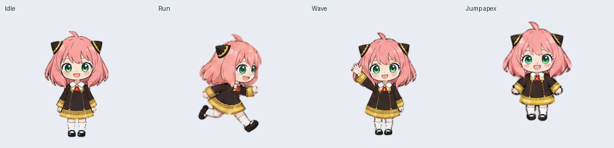
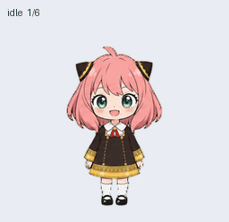
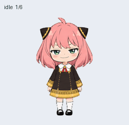

# Anya Codex Pet · 阿尼亚桌面宠物

让阿尼亚陪你写代码。粉色头发、绿色眼睛、黑金发饰，支持九种动画状态和十六个视线方向。

An unofficial, fan-made Anya Forger animated desktop companion for Codex. Includes a big-eyes edition and a classic smug-smile edition.



## 动画预览 / Preview

| 大眼萌版 · Big eyes (default) | 经典坏笑版 · Smirk |
| --- | --- |
|  |  |

## 安装 / Install

需要支持自定义 v2 宠物的 Codex 桌面版本。安装后到 **Settings → Pets** 刷新并选择阿尼亚；若未出现，重启应用。

Requires a desktop version that supports custom v2 pets. Refresh **Settings → Pets**, select Anya, or restart the app if needed.

### 点击安装 / Install link

- [安装大眼萌版 / Install Big Eyes](codex://pets/install?name=Anya%20Big%20Eyes&imageUrl=https%3A%2F%2Fraw.githubusercontent.com%2FRalphFH%2Fanya-codex-pet%2Fv1.0.0%2Fspritesheet.png&description=Anya%20Forger%20-%20big%20eyes%20edition&spriteVersionNumber=2)
- [安装经典坏笑版 / Install Smirk](codex://pets/install?name=Anya%20Smirk&imageUrl=https%3A%2F%2Fraw.githubusercontent.com%2FRalphFH%2Fanya-codex-pet%2Fv1.0.0%2Fvariants%2Fsmirk%2Fspritesheet.png&description=Anya%20Forger%20-%20smirk%20edition&spriteVersionNumber=2)

GitHub 可能不允许直接点击 `codex://` 链接。可复制链接地址到浏览器地址栏，或使用下面的本地安装方式。应用可能会显示安装确认界面。

GitHub may block custom-protocol links. Copy the link address into your browser, or use the local installation below. The app may show an installation confirmation.

### macOS / Linux

```bash
git clone https://github.com/RalphFH/anya-codex-pet.git
cd anya-codex-pet
./install.sh big-eyes
# 可选：同时安装经典坏笑版 / Also install the smirk edition
./install.sh smirk
```

也可以从 [Releases](https://github.com/RalphFH/anya-codex-pet/releases/latest) 下载 ZIP，解压后在目录里运行安装脚本。脚本只复制清单和图集，默认不会覆盖已有文件；更新时使用 `./install.sh big-eyes --force` 或 `./install.sh smirk --force`。

Alternatively, download and extract a ZIP from Releases, then run the installer inside it. The installer copies only the manifest and sprite sheet. Use `--force` to replace an existing installation.

### Windows (PowerShell)

下载并解压发布包，在解压目录打开 PowerShell：

Download and extract the release ZIP, open PowerShell in the extracted directory, then run:

```powershell
# 大眼萌版 / Big eyes
$petDir = Join-Path $HOME '.codex/pets/anya-big-eyes'
New-Item -ItemType Directory -Force -Path $petDir | Out-Null
Copy-Item .\pet.json, .\spritesheet.png -Destination $petDir

# 经典坏笑版 / Smirk (optional)
$petDir = Join-Path $HOME '.codex/pets/anya-smirk'
New-Item -ItemType Directory -Force -Path $petDir | Out-Null
Copy-Item .\variants\smirk\pet.json, .\variants\smirk\spritesheet.png -Destination $petDir
```

自定义 `CODEX_HOME` 时，将 `.codex` 路径替换为对应位置。两版使用不同 ID，可同时安装。

If you use a custom `CODEX_HOME`, use its `pets` directory instead. The two editions have separate IDs and can coexist.

## 内容 / Contents

| 文件 / File | 说明 / Description |
| --- | --- |
| `pet.json`, `spritesheet.png` | 大眼萌版，可直接安装 / Default install-ready pet |
| `variants/smirk/` | 经典坏笑版 / Smirk edition |
| `previews/` | 动画、静态预览及十六方向图 / GIFs, stills and look directions |
| `qa/` | 本次结构验证与原有质量报告 / Structural validation and original quality reports |
| `SHA256SUMS` | 发布资产校验值 / Asset checksums |
| `install.sh` | 本地安装脚本 / Local installer |

## 格式与验证 / Format and validation

- Transparent RGBA PNG, **1536 × 2288** pixels.
- Codex sprite format **v2**, **8 columns × 11 rows**, **192 × 208** pixels per cell.
- Nine animation states: idle, running-right, running-left, waving, jumping, failed, waiting, running (active work), review.
- Sixteen clockwise look directions, from 0° to 337.5°.
- Required frame counts by row: `6, 8, 8, 4, 5, 8, 6, 6, 6, 8, 8`.
- Both exact PNG files were checked with the bundled `validate_atlas.py --require-v2`. See `qa/` for results.

两版沿用之前生成的图集和动画预览，本次发布没有重画角色。原有质量检查与方向盲审报告附在 `qa/`；经典坏笑版保留了四条已复核的方向/连续性警告，详见 `qa/smirk-quality.json`。本次验证确认格式、透明度和帧结构；未在全新桌面安装中做交互测试。

This release packages the existing artwork unchanged. Original quality and blind-direction-review reports are included. The smirk edition retains four reviewed direction/continuity warnings, recorded in `qa/smirk-quality.json`. Packaging checks verify atlas structure and transparency; a fresh interactive desktop installation has not been tested.

## 来源与许可 / Credits and licensing

由 [RalphFH](https://github.com/RalphFH) 整理发布。图像由 OpenAI image generation 生成，动画图集通过配套宠物工具提取、组装和验证。

The [official install-link reference](https://learn.chatgpt.com/docs/app/commands) describes the supported `codex://pets/install` parameters.

安装脚本和文档采用 MIT 许可；角色和视觉资产的说明见 [NOTICE.md](NOTICE.md)。本项目是非官方同人项目，与《SPY×FAMILY》权利方或 OpenAI 均无官方关联。

The installer and documentation are MIT licensed. See [NOTICE.md](NOTICE.md) for the character and visual assets. This fan project is not affiliated with or endorsed by the SPY×FAMILY rights holders or OpenAI.
